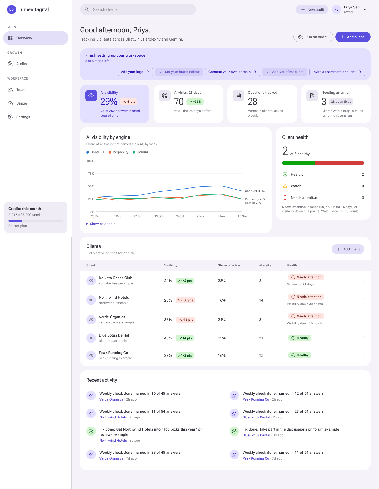
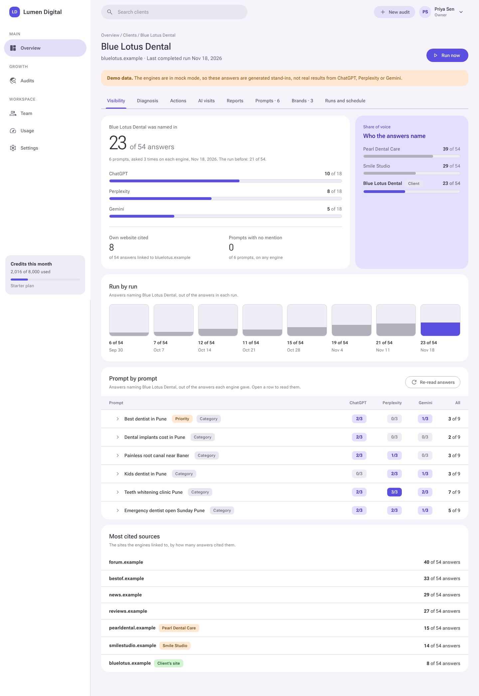
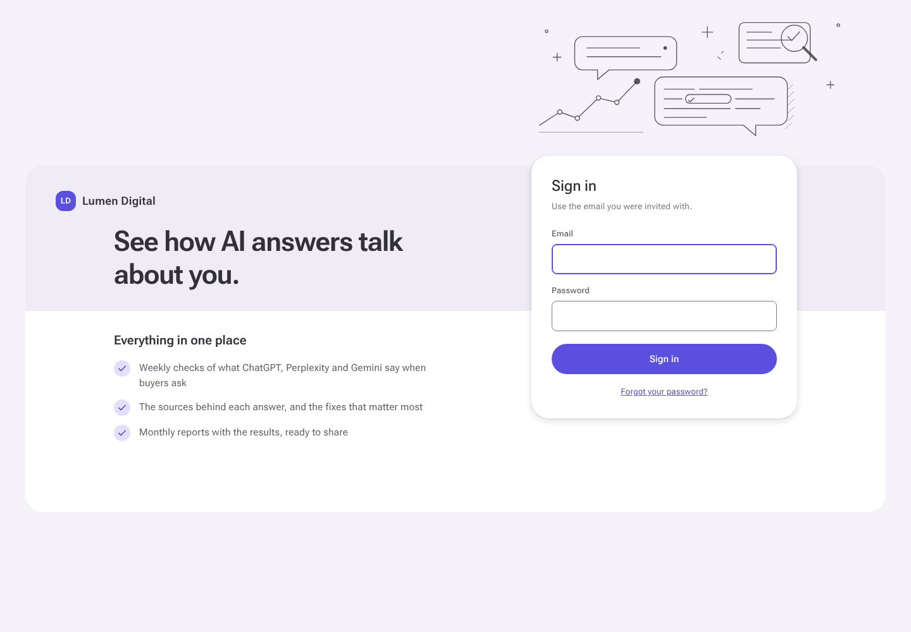
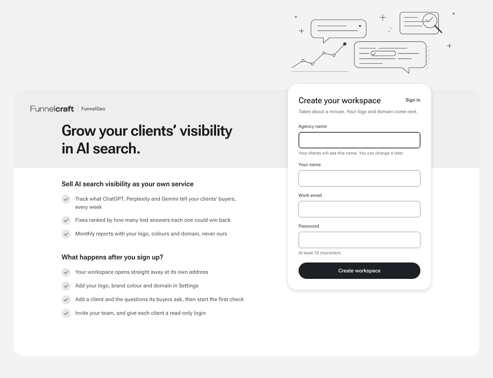
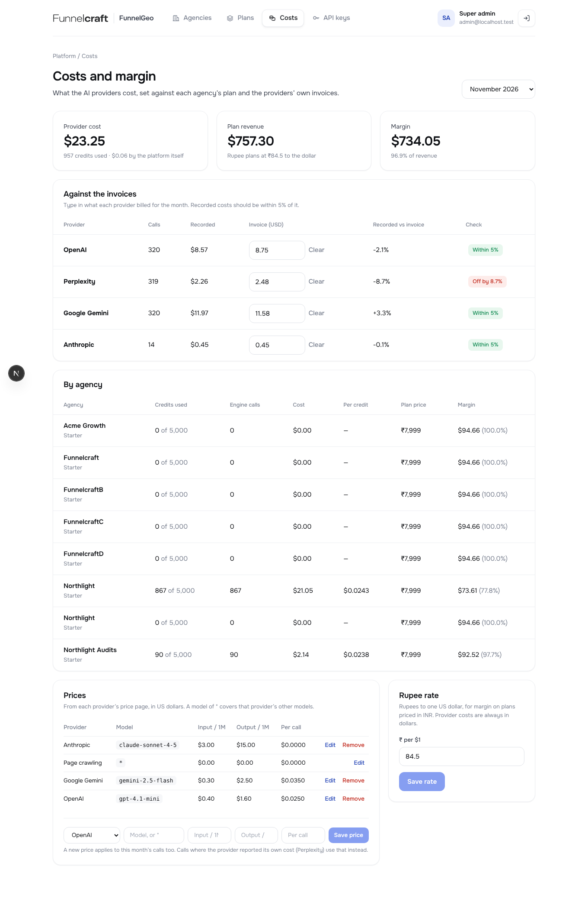

# FunnelGeo

**White-label AI search visibility (GEO) for agencies.** FunnelGeo asks
ChatGPT, Perplexity and Gemini the questions your clients' buyers ask, shows
when each client is named and which sources the engines cite, ranks the fixes
that would win those answers, and proves the result with AI-visit tracking and
monthly reports, all under the agency's own name, logo, colours and domain.

Built by [Funnelcraft](https://funnelcraft.online).



> **Status:** in development, not yet live. Everything below runs locally with
> stand-in engines; real engine costs, payments and the production deployment
> are still to come (see [Open items](#open-items)).

## What it does

| For | What they get |
| --- | --- |
| **Agencies** | A branded workspace at their own subdomain or domain, clients and team logins, prospect audits that turn into clients, and usage and credits per month |
| **Each client** | Weekly checks across AI engines with every answer stored, visibility and share of voice against competitors, the sources behind each answer, a diagnosis of why questions are lost, and a ranked queue of fixes with AI-written briefs, FAQs and outreach drafts |
| **Proof** | A tracking snippet that records visits from AI assistants, before-and-after figures for every finished fix, and monthly reports the agency approves before they go out, as a live link and a PDF |
| **The platform owner** | Plans and credit allowances, the cost of every provider call, margin per agency, and a monthly check that recorded costs match provider invoices within 5% |

Nothing an agency's client sees names FunnelGeo: emails, pages, reports and
PDFs carry the agency's brand only.

| | |
| --- | --- |
|  |  |
| Visibility for one client, by engine and competitor | An agency's own sign-in page, in its brand colour |
|  |  |
| Agency signup on the platform address | Super admin: provider costs against invoices |

## Tech stack

- **Web:** Next.js 15, React 19, Material 3 (colour scheme generated per agency), Roboto Flex, Material Symbols
- **API and workers:** Node.js 22, TypeScript, Fastify 5, zod, BullMQ on Redis 7, puppeteer-core for report PDFs
- **Data:** PostgreSQL 16 with row-level security for tenant isolation
- **AI providers:** OpenAI, Perplexity and Gemini as answer engines; OpenAI, Anthropic or Gemini for writing
- **Tests:** 169 integration tests against real Postgres and Redis with stand-in providers

Start with [Run it locally](#run-it-locally). The developer handbook covers
conventions, testing, deployment and troubleshooting in more depth.

## Open items

- Wildcard and custom domains on Railway (a wildcard domain for agency subdomains, and agencies' custom domains through Railway's API)
- Cost spike with real engine keys, then credit costs and plan prices
- Payments and GST invoices for agencies
- Terms and privacy policy pages
- Continuous integration (typecheck, tests and build on every pull request)

## License and use

Copyright Funnelcraft. All rights reserved. The source is public to read; it is
not licensed for reuse, redistribution or hosting by others. To report a
security problem, see [SECURITY.md](SECURITY.md).

## Build log

**Milestone 2, Foundations** (complete):

- Agency signup; each agency gets `<slug>.<PLATFORM_DOMAIN>`
- Four roles: super admin, agency owner, agency member, client viewer
- Tenant isolation enforced in Postgres with row-level security
- Branding per agency: name, uploaded logo and tab icon, two colours, email
  sender name
- Custom domain by CNAME, with verification and a certificate-check endpoint
- Team invites sent by email (single-use links, 7 days) and client-viewer logins
- Password reset by email; a reset signs the user out everywhere else
- Clients, with the plan's active-client limit
- Super admin: list agencies, change plan, suspend and reactivate

**Milestone 3, Tracker** (complete, tested against stand-in engines):

- Prompts per client (bulk add, priority, type, pause, plan limit) and up to
  five competitors, each with other names and a website
- Runs: every active prompt, on every available engine, the plan's number of
  times; started by hand or on a weekly schedule
- Engine adapters for ChatGPT, Perplexity and Gemini, a queue per engine with
  its own rate limit, retries with backoff, and a worker process
- Each answer is stored in full with its sources; mentions, position and
  citations are derived from it and can be rebuilt ("Re-read answers")
- Visibility screens: counts with sample sizes by engine, share of voice,
  prompt by prompt with the stored answers, most cited sources, run by run
- Credits: the cost of a run is reserved before it starts and failed calls are
  refunded; the ledger is append-only

Not in this milestone, though the PRD lists them under the tracker:

- **Sentiment and indirect references.** Mentions are matched by name, other
  names and website only. Both of these need a language-model pass.
- **Google AI Overviews**, and sending a prompt's country to the engines.
- **Screens for credit settings.** Engine costs, plan allowances and grants are
  set through the super admin API (see `src/routes/admin.ts`).

The weekly schedule is off until someone turns it on for a client, so a new
client never spends credits unasked. The PRD said weekly by default.

**Milestone 4, Prospect audit and lead widget** (complete, tested against
stand-in engines and stand-in websites):

- New audit: business, website, what it does and where; ten suggested buyer
  questions to edit, and competitors suggested by an answer engine
- Each audit asks every question once on each engine and checks the website
  for AI readiness (nine checks, below); it uses one of the plan's monthly
  audits plus credits
- Report: how often the business is named, by engine and against competitors;
  questions where only competitors are named; third-party sites the engines
  cite where the business is missing; the first five fixes, in a fixed order
- Share link on the agency's own address, read-only and replaceable; PDF via
  the browser's print dialog ("Save as PDF"), with a print layout
- Prospects stay out of the client list and the client limit until converted;
  converting keeps the questions, competitors and results
- Website form: one line of code on the agency's site. Each request becomes a
  lead and an audit; the visitor gets the report by email and the agency's
  owners get a lead email. Off by default; rate limited; a hidden field
  catches bots; repeats within a day are ignored; when audits or credits run
  out the lead is still saved and both sides are told
- A report button (text and link) on every shared report, set in Settings

The nine site checks: the site loads; HTTPS; robots.txt lets AI crawlers in
(blocking OAI-SearchBot, PerplexityBot, Claude-SearchBot or Google-Extended
fails, blocking training-only crawlers is a warning); readable without
JavaScript; schema.org structured data; question-and-answer content; page
title and description; sitemap; llms.txt (lowest weight). Up to 10 pages are
read per site.

Not in this milestone: a server-generated PDF file (the browser makes it),
sentiment, and sending the website form's emails from the agency's own domain.

**Milestone 5, Diagnosis** (complete, tested against its exit check: every
lost question in a test client has a cause and at least one linked source).
A Diagnosis tab on each client, for agency staff only:

- A question is *lost* when some competitor was named in more of its answers
  than the client; *won* when the client was named at least as often as every
  competitor; *open* when no tracked brand was named
- One cause per lost question, in one plain sentence, chosen from what the
  lost answers cite, with the sources linked: the client's robots.txt blocks
  that engine's crawler; third-party pages name the competitors (and whether
  each page lists the client); the competitors' own sites are cited; the
  client's site is cited but the client isn't named; or nothing was cited, in
  which case it points to where the winner is cited elsewhere in the run.
  Causes describe what the engines did and never claim to know why
- After each completed run the worker opens up to 40 cited third-party pages
  behind lost answers (reused for 14 days) to check which brands they list,
  through the same guarded fetcher as the website check
- Citation gaps: third-party sites cited in at least two answers that named a
  competitor but not the client
- Source map: every cited site sorted into client's site, competitor's site,
  list or review article, directory or review site, forum or social, news, or
  other. Built-in rules plus the agency's own corrections, which apply to all
  its clients and past runs at once; types are worked out when read, not
  stored on each citation
- Website readiness: the nine checks from audits, re-run with a run when the
  last check is over a week old, or on request
- A run summary email after each run (owners by default; whole team or nobody
  in Settings): named rate against the last run, newly lost and won
  questions, top causes and gaps

Not in this milestone: sentiment, page-level answer-structure scoring (phase
2) and the action queue the causes will feed (milestone 6).

**Milestone 6, Action queue** (complete, tested against its exit check: a
member takes one lost question from suggestion to an exported asset and marks
it done). An Actions tab on each client, for agency staff only:

- Suggestions come from each run's diagnosis, by rules (no model decides what
  to do): a blocked crawler becomes a robots.txt fix; a third-party page that
  doesn't list the client becomes outreach, a listing or a reviews action by
  its type; a question with nothing of the client's to cite becomes a new
  page; the client's page cited without the client named becomes a content
  update; those questions also feed one FAQ action; failing website checks
  become llms.txt and readability fixes
- One open action per problem: later runs update it (questions, impact)
  instead of adding another. Dismissed actions return after 90 days at the
  earliest; done ones after 28 days, so the change after them can be measured.
  Untouched suggestions a later run no longer supports close as "resolved"
- Impact = lost questions addressed, priority questions counting double
  (site-wide fixes show "Whole site"). Effort S, M or L. Statuses: suggested,
  approved, in progress, done, dismissed. An owner from the team
- Generators: content brief, draft in the client's voice (Brands tab), FAQ
  with FAQPage JSON-LD, llms.txt from the sitemap, robots.txt fix from the live
  file, outreach email, listing copy, review request email. The model is told
  never to invent facts and to leave [ADD: …] placeholders; the editor counts
  what's left. Every edit is a new version; files download, never display
- Credits: brief 2, draft 4, FAQ 2, emails and listing 1; robots.txt and
  llms.txt are built by rules and free. Reserved up front, refunded if writing
  fails. Provisional until the cost spike
- Writing model: OpenAI by default, reusing the ChatGPT key and model; Claude
  or Gemini on the API keys screen ("Writing model", with a Test button)
- Done takes the live URL or a note; its date starts milestone 7's before and
  after comparison

Not in this milestone: client approval of actions, task due dates (both
phase 2) and publishing to a CMS (phase 3).

**Milestone 7, Proof** (complete, tested against its exit check: a test
visit from an AI referrer appears in the dashboard within a minute, and a done
action shows its comparison after the next run):

- A one-line tracking snippet per client, served from the agency's own
  address: `<script async src="https://<agency>/t.js" data-site="…"></script>`.
  It sends a visit only when the page was reached from an AI assistant
  (ChatGPT, Perplexity, Gemini, Claude, Copilot, DeepSeek, Meta AI and
  others), by referring site or utm_source; one install ping per browser per
  day; and conversions via `funnelgeo('convert', 'Name')` during an AI visit
- Privacy: no cookies, no IP addresses or user agents stored, the query
  string dropped except utm_source, a random per-tab session id hashed with
  the site key. Visits older than 13 months are deleted
- The collector is its own process (`npm run dev:collector`). It keeps only
  visits that land on the client's own domain, answers 204 to everything,
  rate-limits per address, and dedupes reloads within 30 minutes. Prospects
  aren't tracked. A site key can be replaced if it leaks
- An "AI visits" tab per client (client viewers see it too, without the
  install details): install status with a "Send a test visit" link, totals,
  visits by day, by assistant, landing pages and the latest visits, updated
  every 10 seconds. Test visits are listed but kept out of totals
- Before and after on each done action: how often the client was named on
  the action's linked questions in the 4 weeks before and after the done
  date, by engine, with answer and run counts; plus AI visits to the done URL.
  Labelled improved, no clear change, declined or too early (fewer than 6
  answers either side). Improved or declined needs a change of at least 10
  points that a one-sided two-proportion test puts beyond noise (z ≥ 1.645).
  Worded as what followed the action, never as what it caused

Google AI Overviews and AI Mode arrive as ordinary google.com referrals, so
no snippet can count them; the tab says so.

**Milestone 8, Reports** (complete, tested against its exit check: a report
for a test client generates, is edited, approved and received with agency
branding only):

- One report per client and calendar month: summary, visibility by engine
  against the previous month, share of voice, the trend by run, actions done
  with the change after each, AI visits, next month's plan, and a "how this is
  measured" note. Every rate is shown with what it is out of
- Drafted automatically on the 1st for last month, for every client with a
  completed run that month, with one email per agency to its owners; or for
  any month from the client's Reports tab
- The AI summary (1 credit, refunded on failure) is written only from the
  report's own figures, with rules against claiming an action caused a change.
  The agency edits it and the plan; both are required reading before approval
- Draft → approved → sent. Approving freezes the figures and opens the live
  link; an approved report can be reopened until it is sent. Nothing reaches a
  client without an agency user's approval
- Sending: the worker prints the live page itself to PDF with headless Chrome
  (CHROME_PATH), so PDF and link always match, then emails each recipient from
  the agency's name with the PDF attached. Recipients default to the client's
  dashboard users plus last time's list. The live link works only on the
  agency's own address. Client viewers see their sent reports and PDFs
- Whitelabel: the platform's name appears in no email, PDF or live page. With
  a verified custom domain, its address doesn't either
- SQL dates are kept as 'YYYY-MM-DD' text throughout the API, so periods don't
  shift a day with the server's time zone

**Milestone 9, Plans and super admin** (complete, tested against its exit
check: recorded costs for a test month match the providers' invoices within
5%, and a larger gap is flagged):

- Every engine call, AI writing call (briefs, drafts, report summaries),
  competitor suggestion, API-key test and crawled page writes one row to
  `usage_events`: provider, model, tokens, calls and, where the provider
  reports it (Perplexity), its own dollar cost. Recording never blocks the work
- Cost = the provider's reported cost, else tokens × the model's price plus a
  per-call price (search and grounding fees). Prices are typed in on the Costs
  page from each provider's price page; `*` covers a provider's other models.
  Calls with no price are counted and flagged, never treated as free
- Costs page (super admin): each provider's recorded cost against the invoice
  you type in for the month, marked "Within 5%" only when every call is priced
  and the gap is 5% or less; cost, cost per credit, plan price and margin per
  agency; prices; the rupee rate for INR plans (`USD_INR`)
- Plans page (super admin): create and edit plans (credits, clients, questions,
  samples, audits, price). Changes apply at once. A plan in use can't be retired
- Usage page (agency staff): credits used against the allowance, by kind, by
  client and by day, with a forecast (weekly runs still to come at today's
  questions, plus everything else at this month's pace). Owners are emailed
  once at 80% and once at 100% each month
- At 100% runs, fixes and summaries stop with a clear message, unless an owner
  turns on top-up with a monthly cap. Top-up credits show as overage on the
  Costs page. Charging agencies for plans and overage (payments, GST invoices)
  is not built yet
- Cost data lives in tables the agency database role can't read at all

**Platform API keys** (super admin): one screen for the engine keys and
models and the email server, with a Test button for each. See
[API keys screen](#api-keys-screen).

**Milestone 1, Cost spike**: the script is in `spike/`. It has to be run with
your own API keys; see [Cost spike](#cost-spike).

Not built yet: charging agencies (payments, invoices, GST); real plan prices
wait for the cost spike.

## Design

Material 3 (2025 colour spec), applied to every page.

- Colour: `apps/web/lib/theme.ts` generates every `--md-sys-color-*` role on
  the server. An agency with a brand colour gets a tonal-spot scheme from it,
  with the brand colour itself kept as the button colour when white text reads
  on it (otherwise a darker tone of it). Its accent colour becomes the tertiary
  palette. FunnelGeo's own pages, and agencies without a colour, use a charcoal
  scheme taken from the Funnelcraft wordmark. Success and warning are built the
  same way from fixed hues. Older short names in `globals.css` (`--primary`,
  `--ink`, `--line`…) point at these roles
- Type: Roboto Flex (optical-size cut), on the M3 type scale
- Icons: Material Symbols Rounded, bundled as SVG paths for only the icons in
  use (`apps/web/components/symbols.ts`, made by `scripts/gen-icons.py`)
- Frame: a navigation drawer grouped by section with a credits card at its foot,
  and a top bar with client search and the account menu. Below 1100px wide the
  drawer becomes a modal drawer
- Dashboard (`/clients`): AI visibility, AI visits, questions tracked and
  clients needing attention; weekly visibility by engine; client health
  (needs attention: a failed run, no run for 14 days, or visibility down 10+
  points; watch: down 5–10); a clients table; recent activity. Served by
  `GET /v1/overview`, which client viewers can call too: row-level security
  limits them to their own client
- Sign-in pages: a light band with a line drawing, the headline and what you
  get on the left, the form in a raised card. Signup and the platform sign-in
  describe FunnelGeo to agencies; an agency's own sign-in page shows only the
  agency's name, logo and colours
- Charts use a fixed, colour-blind-checked order for engines (blue, orange,
  teal) with direct labels and a table view

To see it with data, `node --env-file=.env scripts/seed-demo.mjs` (development
only, mock engines) creates "Lumen Digital" with five clients and eight weeks of
runs: sign in at `http://lumen-digital.localhost:3000` as `priya@lumen.test`.

## Layout

```
apps/api    Fastify + TypeScript API. SQL migrations in apps/api/migrations.
apps/web    Next.js app, themed per hostname. Proxies /api/* to the API.
spike/      Cost spike script (no dependencies).
infra/      Example reverse-proxy config for custom domains.
```

## Run it locally

Needs Node 22.9+, Postgres 16 and Redis 7 (the versions tested;
`docker compose up -d` starts both).

```bash
cp .env.example .env          # then set SESSION_SECRET and INTERNAL_PROXY_SECRET
npm install
npm run migrate               # creates tables, policies and the geo_app login
npm run seed:admin            # optional: set SUPER_ADMIN_* in .env first
npm run dev:api               # terminal 1, port 4000
npm run dev:web               # terminal 2, port 3000
npm run dev:worker            # terminal 3: makes engine calls, runs schedules
```

- Platform address: http://localhost:3000 (signup, super admin sign-in)
- An agency's workspace: http://your-agency.localhost:3000

Browsers resolve `*.localhost` to your machine, so no DNS setup is needed.
With `SMTP_URL` empty, invite and reset emails are printed in the API
terminal instead of being sent.

If you are not using `docker compose`, create the owner role and databases
first:

```sql
CREATE ROLE geo_owner LOGIN PASSWORD 'geo_owner' CREATEROLE;
CREATE DATABASE geo_dev OWNER geo_owner;
CREATE DATABASE geo_test OWNER geo_owner;   -- for npm test
```

## Tests

```bash
npm test          # 169 integration tests; needs Postgres (geo_test) and Redis
npm run typecheck
npm run build
```

The tests wipe and rebuild `geo_test` on every run. They cover tenant
isolation at the API and directly at the database, roles, whitelabel, plan
limits, suspension, emails, password reset, uploads, the tracker (a 25-prompt
run end to end, parsing, retries, refunds, schedules, credits) and audits (the
site check, address safety, reports, share links, conversion, the website
form and its emails, limits).

## How tenant isolation works

1. **Hostname decides the tenant.** The API maps the hostname to the platform,
   one agency, or nothing (`src/tenant.ts`). A custom domain maps to an agency
   only after its CNAME is verified.
2. **Sessions are bound to a hostname.** The cookie is host-only and the token
   carries the agency id; a session from one workspace is rejected on any
   other, and super admin sessions work only on the platform address.
3. **The database enforces it again.** Tenant requests use the `geo_app` role
   inside a transaction that sets `app.agency_id` (`withTenant` in
   `src/db.ts`). Row-level security policies filter every table on it, so a
   query that forgets a `WHERE agency_id = ...` still cannot cross tenants.
   Client viewers also set `app.client_id`, which narrows them to one client.
4. **Cross-tenant work is explicit.** Signup, login lookup, hostname
   resolution, invite acceptance, password reset and super admin use the owner
   role (`ownerPool` / `withSystem`). Keep that list short.

When you add a tenant table: add `agency_id`, enable row-level security, add
policies in the same migration, and add a case to the isolation test.

## API keys screen

The super admin enters engine keys and models, the SMTP connection and the
send-from address at **/admin/settings** on the platform's own address (nav:
"API keys"). Each engine and the email server has a Test button that makes one
real call (a short question, or an email to the super admin's own address).

- Secrets are encrypted in the application with AES-256-GCM before they reach
  the database, using `SETTINGS_ENCRYPTION_KEY` (32 bytes, base64:
  `openssl rand -base64 32`). The setting's name is bound into each value, so a
  value can't be moved to another setting's row. Without that key the screen
  says so and refuses to save secrets.
- Keep the encryption key out of database backups and keep a copy safe. If it
  is lost or changed, saved secrets show as "can't be read" and must be
  entered again.
- A key is never sent back to the browser, only its last four characters.
- Only the owner database role can touch `platform_settings`; the tenant role
  (`geo_app`) has no privileges on it.
- A saved value wins over the environment variable of the same name; removing
  it falls back to the environment. The API and every worker re-read settings
  every 15 seconds, so changes need no restart.

## Answer engines

Set `ENGINE_MODE=live` and, for each engine you want, its API key and model,
on the API keys screen or as `OPENAI_*`, `PERPLEXITY_*`, `GEMINI_*` in the
environment. An engine with either missing is simply not used. The three request formats were checked against the
providers' documentation on 16 Nov 2026 but have not been run against the live
services; run `spike/cost-spike.mjs` with your keys first, since it uses the
same formats.

`ENGINE_MODE=mock` answers every call with generated stand-in text so the
whole product can be tried without keys. Runs made this way are labelled
"demo data" everywhere, and the API refuses to start in this mode when
`NODE_ENV=production`. Brand names are never sent to a live engine: it sees
the prompt and nothing else.

## Credits

One credit per engine call by default (`engines.credit_cost`). A plan's
`monthly_credits` is the allowance for a calendar month (UTC); the balance is
that allowance plus the month's ledger entries. The current allowances are
provisional: enough for every client on the plan to run weekly. Set real
values after the cost spike:

```
PATCH /v1/admin/engines/:key      { "creditCost": 2 }
PATCH /v1/admin/plans/:key        { "monthlyCredits": 8000 }
POST  /v1/admin/agencies/:id/credits { "amount": 1000, "note": "..." }
```

Plans are also edited on the Plans page. Monthly use, top-up and the 80% and
100% emails are on each agency's Usage page.

**Checking costs each month**: after the month closes, open Costs, pick the
month, and type in each provider's invoice total in dollars. If a provider is
not "Within 5%", the usual causes are a missing or outdated price (check the
Prices card for unpriced models), a fee the price doesn't cover (add it as the
per-call price), or usage outside FunnelGeo on the same API key. Use a key for
FunnelGeo alone so the invoice and the records describe the same calls.

## Website checks and safety

The site check fetches whatever website a member of the public types into the
website form, so `src/audits/fetch.ts` refuses anything that is not on the
public internet: every connection, including each redirect, is checked after
DNS resolution, so a name pointing at 127.0.0.1, 10.x, 169.254.169.254 (cloud
metadata) and similar is refused. Only ports 80 and 443, at most 3 redirects,
10 seconds and 1.5 MB per page. The user agent is a neutral
`AI-Readiness-Check/1.0`, so prospects' logs do not name the platform.

`SITE_FETCH=mock` checks a made-up website instead, for development without
internet access; reports made that way are labelled demo data, and the API
refuses to start with it in production.

Every page refuses to be shown inside another site's frame, except the
website form under `/embed/`. Shared reports send no referrer (their links go
to other sites) and ask search engines not to index them.

## Whitelabel rules

- The platform name and the Funnelcraft logo appear only on the platform's own
  address (landing, signup, super admin).
- On an agency's address everything is the agency's: tab title and icon, logo,
  colours, and the sender name, logo and button colour of every email. The
  embed code for the website form names only the agency's address.
- The design system (`apps/web/app/globals.css`) takes two colours from the
  agency, `--primary` and `--accent`; every other colour is neutral.

## Email

Any SMTP provider works; set the SMTP connection and send-from address on the
API keys screen, or `SMTP_URL` and `MAIL_FROM` in the environment. All emails are sent
from the one `MAIL_FROM` address with the agency's name as the display name,
so set up SPF and DKIM for that address's domain with your provider. Sending
from each agency's own domain is not built yet.

## Uploads

Logos and tab icons are stored on disk in `UPLOAD_DIR` (PNG, JPEG or WebP, up
to 1 MB; the type is checked from the file's bytes, and SVG is refused because
it can carry scripts). Keep that directory on persistent disk and back it up.
If the API ever runs on more than one machine, move this to shared object
storage first; `src/routes/files.ts` is the only file that touches the disk.

## Deploying

- Run three processes: the API (`npm start -w @geo/api`), at least one worker
  (`npm run start:worker -w @geo/api`) and the web app, plus Postgres and Redis.
- Run the API on a private address. It trusts the forwarded hostname only from
  callers that send `INTERNAL_PROXY_SECRET`; the web app sends it.
- Put a reverse proxy in front of the web app that preserves the `Host`
  header and issues certificates on demand. `infra/Caddyfile.example` shows
  this with Caddy, using `GET /internal/domain-check` so certificates are only
  issued for known workspaces. **That file has not been run**; test it on the
  server before pointing real domains at it.
- Point `*.PLATFORM_DOMAIN` and `CNAME_TARGET` at that proxy.
- Set `SETTINGS_ENCRYPTION_KEY` on the API and the workers (the same value on
  every process), before entering any keys on the API keys screen.
- Set `NODE_ENV=production` (secure cookies), `PUBLIC_SCHEME=https` and an
  empty `PUBLIC_PORT`.
- In production the owner role should not be a superuser, and `geo_app` must
  never be one (superusers bypass row-level security).
- Shared hosting cannot run this; use a VPS or a container platform.

### On Railway

The `Dockerfile` builds one image for every service; each service's start command comes from its config file in `infra/railway/` (set it under the service's Settings → Config-as-code). One project holds six services:

| Service | Config file | Notes |
|---|---|---|
| Postgres | (Railway database) | |
| Redis | (Railway database) | |
| api | `infra/railway/api.json` | Runs migrations before each deploy. Private only: `HOST=::`, `PORT=4000`. Volume at `/data`, `UPLOAD_DIR=/data/uploads` |
| worker | `infra/railway/worker.json` | `INSTALL_CHROMIUM=true` (build arg), `CHROME_PATH=/usr/bin/chromium` |
| collector | `infra/railway/collector.json` | Private only: `HOST=::`, `COLLECTOR_PORT=4100` |
| web | `infra/railway/web.json` | The only public service, port 3000. `API_URL=http://api.railway.internal:4000`, `COLLECTOR_URL=http://collector.railway.internal:4100` |

Shared variables: `DATABASE_OWNER_URL` (the Postgres service's `DATABASE_URL`), `DATABASE_URL` (the same host and database as user `geo_app` with `APP_DB_PASSWORD`), `REDIS_URL` (the Redis service's URL plus `?family=0`, since Railway's private network is IPv6), `SESSION_SECRET`, `INTERNAL_PROXY_SECRET`, `SETTINGS_ENCRYPTION_KEY`, `PLATFORM_DOMAIN`, `PUBLIC_SCHEME=https`, empty `PUBLIC_PORT`, `NODE_ENV=production`.

Agency subdomains need a wildcard domain (`*.PLATFORM_DOMAIN`) on the web service. Until one is added, `PLATFORM_DOMAIN` can be the web service's `*.up.railway.app` address: signup and super admin work there, but agency workspaces do not open.

## Cost spike

Measures what one engine call costs before plan prices are set.

```bash
cp spike/.env.example spike/.env            # add keys, models and prices
cp spike/prompts.example.json spike/prompts.json
node --env-file=spike/.env spike/cost-spike.mjs --prompts 25 --samples 3
```

It prints success rate, latency, tokens, share of answers with citations and
cost per client per month for each engine, and writes per-call rows to
`spike/results/`. The request and response formats were checked against each
provider's documentation on 16 Nov 2026 and the report logic is tested against
a mock, but the script has not been run against the live APIs.
